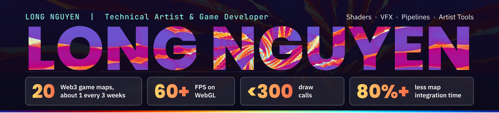

### ◆ SUMMARY

Technical artist with a software engineering background and 4+ years building cross-platform games (mobile, PC, WebGL) in Unity and Unreal Engine, connecting art and engineering through real-time shaders, VFX pipelines, performance optimization, and Unity Editor tools, including AI-assisted workflows.

### ◆ FEATURED PIPELINE

**AI Game VFX: Effect Pipeline – Unity 6 (URP)** · `Personal project · 2026`

An engine-independent VFX knowledge base and pipeline; each effect is described as data and built into engine assets.

`Textures` → `Effect data` → `Editor builder` → `Validation` → `Batch CLI`

- Generic Unity Editor builder that generates effect prefabs from JSON specs and checks performance budgets and art rules on every build.
- VFX settings database (2,478 effects, 8,414 layers) and a 2,511-image texture library, with Python tools to query and audit them.
- AI image generation (Gemini) and AI coding agents (Claude Code) integrated into the art and engineering workflow.

### ◆ SHADERS & RENDERING

| Project | Highlights |
| --- | --- |
| **[Unity Shaders & VFX](https://buciupi.github.io/assets/projects/unity-shader.html)** | Shell texturing, hex shield, force field, hologram mapping, toon water, VFX Graph particles |
| **[Unreal Engine 5 Custom Materials](https://buciupi.github.io/assets/projects/unreal-engine-shader.html)** | Vertex displacement, interior mapping, tessellation, procedural hex grid, underwater with caustics |
| **[DirectX 11 Render Pipeline](https://buciupi.github.io/assets/projects/directx11.html)** | Forward and deferred, PBR lighting, shadow mapping, SSAO, GPU instancing, occlusion culling |

### ◆ ARTIST TOOLS

| Tool | Stack | Flow |
| --- | --- | --- |
| **ArtWorkflow** | Python | `Large map` → `Tiles` → `ChatGPT` → `Best seam` |
| **Image to PSD** | Python | `Flat image` → `RapidOCR` → `Type layers` → `PSD` |
| **Asset Import Pipeline** | Unity Editor, batch mode | `Art folder` → `Validate` → `Prefab` → `PR branch` |
| **Asset Health Toolkit** | Unity Editor, CLI | `Scan` → `References` → `Duplicates` → `CLI` |
| **Rendering & Texture Tools** | Unity Editor | `Anim clips` → `Sample` → `Bounds` |
| **QA & Authoring Tools** | Unity Editor | `Routes` → `Validate` → `Heatmap` |
| **Socket Automation & Rigging Guide** | Python, Blender to Unity | `SK_ + SM_` → `Parent, align` → `Batch export` |
| **[Graphics Studies](https://github.com/BuCiuPi/MeshProcedural)** | Unity, GLSL | `Raymarching` · `Mesh API` · `Burst` · `DOTS` |

### ◆ SKILLS

**Shading** HLSL, GLSL, ShaderLab, Shader Graph, Raymarching / SDF 
**VFX & Rendering** Particle System, VFX Graph, Niagara, URP, Post-processing, Sprite Rigging 
**Art Tools** Blender, Maya, Photoshop, Substance Designer, Substance Painter 
**Engines** Unity, Unreal Engine 5, UEFN 
**Optimization** Unity Profiler, Frame Debugger, RenderDoc, LOD, Texture Compression, WebGL Performance

### ◆ CONTRIBUTIONS

